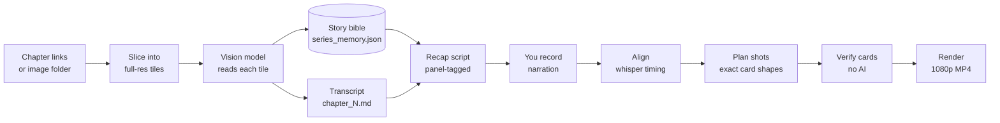

<div align="center">

# 📖➜🎬 manhwa-ocr

**Turn any webtoon chapter into a recap video, synced to your own voice.**

Read the pages with a vision model. Remember every character. Write the recap. Record it.
Get a 1080p video, cut to your narration, from one terminal command.


[Quick start](#-quick-start) ·
[How it works](#-how-it-works) ·
[Make a video](#-make-a-video) ·
[Commands](#-commands) ·
[Providers](#-providers) ·
[FAQ](#-faq) ·
[Limits](#-honest-limits)

</div>

---

## ✨ What you get

| You give it | You get |
|---|---|
| Chapter links, or a folder of page images | A clean **transcript** of every chapter (dialogue, narration, sound effects) |
| Nothing extra | A **story bible** that remembers characters, looks, names and plot threads across chapters |
| The transcripts | A **recap script** per chapter, tagged with the panel each sentence describes |
| Your recorded narration (`.mp3`) | A **1080p recap video**: hard cuts, blurred backgrounds, bordered cards, synced to your voice |

No vendor SDKs. No GPU needed. Plain HTTP to Claude, Gemini, OpenAI-compatible endpoints (OpenRouter, Groq, DeepSeek, LM Studio, vLLM) or local Ollama.

---

## 🚀 Quick start

```bash
git clone https://github.com/itsakash-real/MahwaOCR-Video-.git
cd MahwaOCR-Video-
pip install -e ".[video,sync]"
```

Then, for a series you have already transcribed and recorded narration for:

```bash
python -m manhwa_ocr video build --chapters 8 --session "my-series" --force
```

That one command aligns the narration, plans every shot, checks every card, and renders the video.
Measured on a 4-core laptop: **a 5-minute chapter builds in about 11 minutes.**

> 🧭 **Never used it?** Double-click `Open_Video_Guide.bat` (Windows) or open
> [`docs/video_guide.html`](docs/video_guide.html). It is a click-through decision tree: find your situation, copy the command.

---

## 🧠 How it works



### The three ideas that make it good

**1. Tall-strip slicing.** Webtoon pages are around `900 × 16000` px. Give one to a vision model whole and it is shrunk to ~110 px wide before it sees a letter. This tool cuts each page into overlapping full-resolution tiles and snaps each cut to a flat gutter between panels, so speech bubbles are never bisected.

**2. Persistent story memory.** After every chapter the model updates `series_memory.json`: characters (with *appearance*), world rules, terms, open threads. That file is fed into every later chapter. A character introduced as "silver hair, red eyes, black gloves" in chapter 1 is correctly named when they reappear unnamed in chapter 6. The file is plain JSON, meant to be hand-edited, and safe to commit.

**3. A video stage with no AI judgement at render time.** Which panel shows for which sentence is decided once, deterministically, and written to `chapter_N.alignment.json`. The planner only lays out what that file says. Every card is then checked on its own pixels before rendering.

---

## 🎬 Make a video

```bash
python -m manhwa_ocr video build --chapters 8 --session "my-series" --force   # build + render
python -m manhwa_ocr video clip  --chapter 8 --from 60 --to 80 --session "my-series"   # 20-second preview
python -m manhwa_ocr video status --session "my-series"                         # what is done
```

Put your narration at `<series folder>/audio/chapter_N.mp3`. The text to read is in `recaps/chapter_N.tts.txt`.

### What the video looks like

- **Hard cuts**, one shot per sentence, never shorter than 3 seconds
- **Cards in exact shapes:** 9:16, 3:4, 1:1, 4:3, 16:9, all with one fixed area per layout so nothing looks uneven
- **Single, side-by-side and wide layouts**, over a darkened blurred copy of the same picture
- **White border, rounded corners, drop shadow** on every card
- Mostly still pictures with slight eased movement, like the recap channels this is modelled on
- **Speech bubbles are painted out**; sound-effect lettering is kept
- **Every drawn panel appears**; only lettering-only pages, blank pages and credits are left out, and each is listed

### Checks that run on every build

| Check | What it catches |
|---|---|
| Alignment validation | panels that do not exist, backward jumps, timing gaps |
| Card shape | any card that is not one of the five allowed shapes |
| Coverage | any drawn panel that would never appear |
| Minimum hold | any shot under 3 seconds |
| Verify (`video verify`) | lettering, painted patches, blank pages, heads that may be cut; re-crops where a clean window exists |

Everything above runs without an AI model, and writes its findings to `video/chapter_N.qa.json` and `video/chapter_N.verify.json`.

### Optional: a second pair of eyes

Some faults (a face cut in half, a wrong picture for a sentence) are easiest to judge by looking. Two optional ways:

- **An IDE agent** reads the storyboard and your narration, and writes fixes to `video/chapter_N.fixes.json`.
- **From the terminal, with a vision model:** `video review` does the same loop: look, fix, rebuild, look again, approve.

Fixes are validated as a whole: a bad entry rejects the file and nothing is applied. Set `video.require_review: true` to make a render wait for approval. Details and the copy-paste agent prompt are in [`USER_GUIDE.md`](USER_GUIDE.md).

---

## 🧰 Commands

| Command | What it does |
|---|---|
| `next` | Prints exactly what to do next. Safe to run any time. |
| `start "Series" <urls…>` | Begin a series: its own folder, memory and recaps |
| `run --next` / `--all-pending` | Transcribe chapters with an API key (provider mode) |
| `prepare` · `assemble` · `finalize` | The same job done by an agent, as file handoffs (no key) |
| `recap --chapters 1-4 --prepare` | Write recap narration, one file per chapter |
| `compile --chapters 1-4,11` | Stitch recaps into one video script, with a runtime table |
| `video pair` | Check every sentence's picture; flags sentences that carry several tags |
| `video build` | Align, plan, check and render, in one go |
| `video verify` · `review` · `approve` | Check cards, run the reviewer, approve a plan |
| `video intro` (`--prepare` first) | Build chapter 0, a trailer from panels of any chapters |
| `video clip --from A --to B` | Cut a short preview or a Shorts clip |
| `video compile --chapters 1-7` | Join chapter videos with title cards |
| `status` · `video status` | Progress per chapter |
| `ui` | Local dashboard at `http://127.0.0.1:8765` |
| `memory show` | The story bible, exactly as the model sees it |

Use the module form everywhere if `manhwa-ocr` is not on your PATH: `python -m manhwa_ocr <command>`.

---

## 🔌 Providers

Transcription and recap writing work with any of these. The video stage needs none.

| Provider | Setting | Key |
|---|---|---|
| Anthropic (Claude) | `kind: anthropic` | `ANTHROPIC_API_KEY` |
| Google Gemini | `kind: gemini` | `GEMINI_API_KEY` |
| OpenAI-compatible (OpenRouter, Groq, Together, DeepSeek, LM Studio, vLLM) | `kind: openai` + `base_url` | your key's env var |
| Ollama (local, free) | `kind: ollama` | none |
| **No key at all** | *agent mode*: your IDE agent does the reading | none |

```yaml
# manhwa-ocr.yaml
provider:
  kind: openai
  base_url: https://api.deepseek.com
  vision_model: deepseek-flash
  text_model: deepseek-chat
  api_key_env: DEEPSEEK_API_KEY
```

---

## 🗂 Where things live

```
manhwaOCR/                       the program
├── manhwa_ocr/                  source code
│   └── video/                   panels · align · plan · verify · fixes · review · frames · render
├── docs/video_guide.html        click-through guide
├── Open_Video_Guide.bat         double-click to open it
└── manhwa-ocr.yaml              your settings

ManhwaRecaps/<series>/           your output (kept outside the program folder)
├── chapter_N.md                 transcripts
├── series_memory.json           the story bible (hand-editable)
├── recaps/                      scripts, TTS text, panel tags
├── audio/chapter_N.mp3          your narration
└── video/                       alignment, plan, QA, verify, fixes, MP4s
```

---

## ❓ FAQ

**Do I need an API key?** No. Agent mode lets an IDE agent do the reading. The video stage needs no model at all.

**Does it work on Windows?** Yes, that is where it is developed and tested. macOS and Linux are untested here; the code is plain Python and FFmpeg via imageio, so they should work.

**Why not Tesseract?** Comic lettering is stylised and sits on art. A vision model reads the page the way a person does and can tell dialogue from narration from sound effects.

**A build failed with red text.** Open `docs/video_guide.html`, section "Something failed". The common ones: missing audio file, or narration too short for the number of panels.

**How do I stop a panel from showing?** Add it to `drop` in `video/chapter_N.fixes.json` and build again.

---

## ⚠️ Honest limits

- **Faces:** finding a head without an AI model uses skin colour and outline heuristics. It also looks for pale, silver-haired and gray-skinned heads, and never starts a card in the top quarter of a figure it cannot place, but those are the least certain heads. The verify report lists them under `low_confidence_heads`, and the reviewer step exists for exactly this.
- **Long holds:** when several sentences in a row describe one panel, that panel can stay on screen for 10+ seconds. A maximum hold per panel is planned.
- **Terminal reviewer:** `video review` is built and tested with a fake provider, but has not yet been run against a real chapter with a live model.
- **Build time:** about 11 minutes per 5-minute chapter on 4 cores. Rendering is the slow part; changed shots only are re-rendered on a second run.
- **Copyright:** this tool transcribes images you point it at. Use it on material you have the right to process.

---

## 🛠 Develop

```bash
pip install -e ".[dev]"
python -m pytest tests/ -q        # 356 tests
```

- **New site:** subclass `Scraper` in `scrapers.py`.
- **New model backend:** subclass `Provider` in `providers.py`, register it in `PROVIDERS`.
- **Different prompt:** edit `prompts.py` and bump `PROMPT_VERSION` (it is part of the cache key).

Contributors and AI agents: read [`AGENTS.md`](AGENTS.md) first. Design notes for the video stage are in [`docs/VIDEO_BUILD_PLAN.md`](docs/VIDEO_BUILD_PLAN.md).

---

## 📜 License and use

MIT, as declared in `pyproject.toml`.

Comics are copyrighted and most reader sites forbid automated access. Use this on your own scans, licensed copies, public-domain work, or content you have permission to use. Check each site's terms and `robots.txt`, keep `download.delay` set, and do not republish transcripts of licensed work.

<div align="center">

**If this saved you hours, a ⭐ helps other people find it.**

</div>
