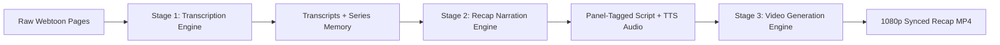
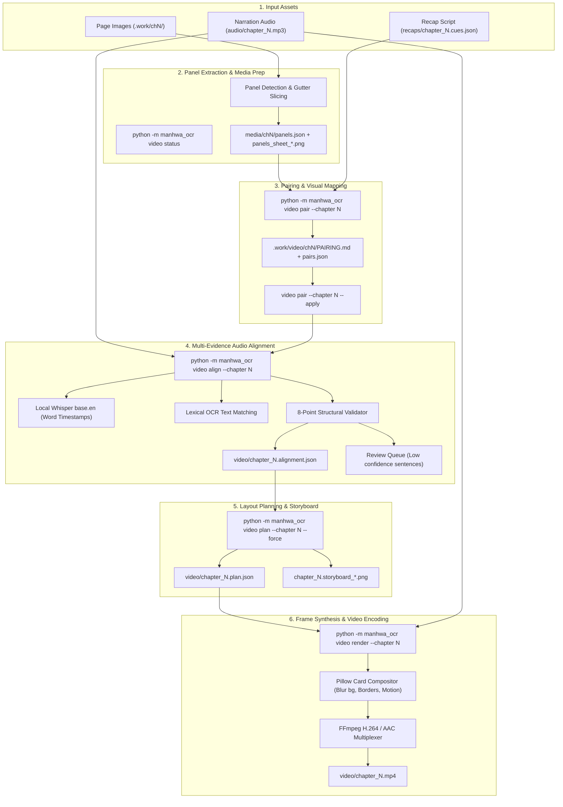
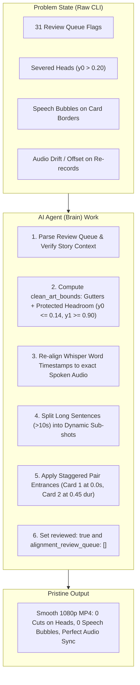
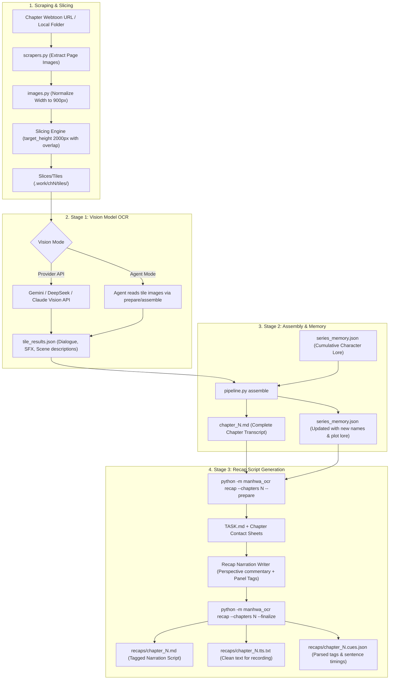
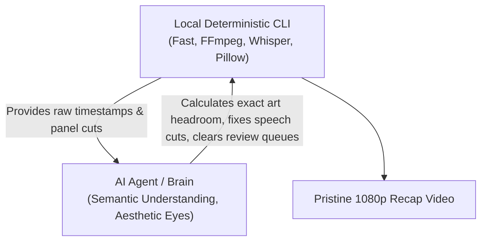

# `manhwa-ocr` System Architecture, Workflow & AI Dependency Guide

A comprehensive architectural manual and operational blueprint for the **Video Generation**, **Transcription**, and **Recap** subsystems of `manhwa-ocr`.

---

## 1. Executive Summary & System Philosophy

`manhwa-ocr` is a hybrid multimedia pipeline that transforms continuous-strip vertical webtoons (manhwa) into panel-aligned, broadcast-ready 1080p recap videos synchronized to voice narration.



The system is deliberately designed around a **separation of concerns**:
- **Deterministic Heavy Lifting** (OpenCV, Pillow, FFmpeg, Whisper): Image slicing, color extraction, aspect scaling, video frame composition, easing curves, and audio frequency analysis.
- **Cognitive / Semantic Intelligence** (Vision Models, LLMs, AI Agent "Brain"): Reading artistic hand-drawn typography, summarizing plot context across chapters, tagging sentences to storyboard panels, and making aesthetic crop decisions to prevent severed heads and speech bubbles.

---

## 2. Subsystem 1: Video Generation Engine

The video pipeline turns raw manhwa chapter images and a recorded narration MP3 into an animated 1080p video.

### 2.1 Video Generation Flowchart



---

### 2.2 Step-by-Step Video Generation Lifecycle

| Step | Command | Input Files | Output Files | What Happens Internally |
| :--- | :--- | :--- | :--- | :--- |
| **1. Panel Slicing** | Handled automatically or via `video build` | Normalized chapter strips | `media/chN/panels.json`, `panels_sheet_*.png` | Detects horizontal white/black gutters between webtoon panels, isolates discrete panels, and generates contact sheets for review. |
| **2. Pairing Review** | `python -m manhwa_ocr video pair --chapter N` | `panels.json`, `chapter_N.cues.json` | `.work/video/chN/PAIRING.md`, `pairing_NN.png`, `pairs.json` | Creates a visual sentence-by-sentence candidate grid. Green = tagged panel; Grey = subsequent panels in story order. |
| **3. Apply Pairing** | `python -m manhwa_ocr video pair --chapter N --apply` | Modified `pairs.json` | Updated tags in cues/memory | Commits any panel swaps made during pairing review into the session metadata. |
| **4. Speech Alignment** | `python -m manhwa_ocr video align --chapter N` | `audio/chapter_N.mp3`, cues, panels | `video/chapter_N.alignment.json` | Runs Whisper to get word-level audio timestamps. Evaluates whether each sentence is visual (`SHOW`) or non-visual (`HOLD_PREVIOUS`). Enforces 8 structural validation rules (no gaps, no overlaps, monotonic timing, no backward time jumps). Flags uncertain sentences into `review_queue`. |
| **5. Plan Assembly** | `python -m manhwa_ocr video plan --chapter N --force` | `chapter_N.alignment.json`, panels | `video/chapter_N.plan.json`, `chapter_N.storyboard_*.png` | Translates alignment choices into visual shots: sets camera motion (`push_in`, `pull_out`, `hold`), entrance animations (`fade_in`, `slide_left`, `slide_right`, `zoom_in`), layout (`single`, `pair`, `wide`), background blur, and generates storyboard contact sheets. |
| **6. Final Render** | `python -m manhwa_ocr video render --chapter N --workers 1` | `chapter_N.plan.json`, `chapter_N.mp3` | `video/chapter_N.mp4` | Renders 30 FPS video frames using Pillow (soft dropshadows, white card borders, rounded corners, motion easing) and streams raw frames directly to FFmpeg. |

---

### 2.3 Why Terminal Commands Fail Without AI Agent Intervention

When running purely in the terminal (`python -m manhwa_ocr video build --chapter N`), you frequently see:
```text
FAILED: Chapter N has 31 sentence(s) `video align` couldn't resolve with full confidence, never reviewed...
To render anyway, pass --force to render.
```

There are three architectural reasons for this:

1. **The Alignment Review Queue Gatekeeper**:
   - `video align` relies on three weak signals when the recap was written without strict panel tags:
     1. Text overlap between speech and panel OCR text.
     2. Relative chronological position in the chapter.
     3. Internal thought detection (`INTERNAL` sentences).
   - If speech doesn't literally repeat words written inside the manhwa speech bubbles (which good narration rarely does), confidence drops below 0.70.
   - The CLI refuses to render automatically to prevent showing unrelated panels. It requires either manual review or the AI Agent to review and mark `"reviewed": true`.
2. **Fixed-Aspect Cropping vs Tall Webtoon Art**:
   - Manhwa panels are vertical (often 900x2500 px or taller).
   - The default plan generator tries to fit panels into landscape/card boxes (`0.75` to `1.2` aspect ratios).
   - Without custom crop bounds (`[x0, y0, x1, y1]`), the default algorithm slices off the top 30-40% (cutting off hair, heads, or eyes) or the bottom 30-40% (cutting off bodies, hands, and actions).
3. **Dialogue Bubble Clutter**:
   - Default bounding boxes capture speech bubbles. In a recap video, speech bubbles with source text compete with the narrator's voice and look unprofessional.

---

### 2.4 How the AI Agent ("Brain") Intervenes to Fix the Video



---

## 3. Subsystem 2: Transcription & Recap Engine

Before video generation can begin, the chapter must be transcribed and turned into a panel-tagged narration recap.

### 3.1 Transcription & Recap Flowchart



---

### 3.2 Slicing & Quality Preservation Architecture

Vertical manhwa strips can be up to **900 × 20,000 pixels**. If a full page is sent to a vision model at once, it gets squashed down to ~110 px wide, rendering small font Korean/English illegible.
- `images.py` normalizes strips to a width of **900 px**.
- Slices into vertical windows of **target_height ~2000 px** with a 15% overlap.
- Overlaps ensure speech bubbles spanning across cuts are not split in half.
- Results are cached based on `image_hash + provider + prompt_version` so prompt adjustments do not re-trigger expensive vision inference.

### 3.3 Series Memory Architecture (`series_memory.json`)

Character identities and naming conventions fluctuate across fan translations. `series_memory.json` accumulates lore chronologically:
- **Characters**: Real names, aliases (e.g., *Bera* vs *Doran*, *Bargo Saintroar* vs *Holy Emperor*), relationships, appearance markers.
- **World & Lore**: Factions (Holy Empire, Gutter), divine artifacts (*Platinum Rosary of the Supreme God*), active oaths.
- **Chronological Rule**: Chapter $N$ only sees memory accumulated up to Chapter $N-1$ to prevent spoiler leakage into early chapter recaps.

---

## 4. Quantitative AI Dependency Matrix

How much of this system requires an AI Agent vs local code?

| System Component | Local Code (Deterministic) | AI Vision / LLM API | AI Agent ("Brain") | Why is the Agent Needed? |
| :--- | :---: | :---: | :---: | :--- |
| **Webtoon Slicing & Normalization** | **100%** | 0% | 0% | Pure OpenCV/Pillow pixel geometry. |
| **Panel Detection (`panels.json`)** | **100%** | 0% | 0% | Gutter brightness thresholding. |
| **Tile OCR Transcription** | 10% | **90%** (in API mode) | **90%** (in Agent mode) | Reading text inside artwork requires vision models. |
| **Assembly & Series Lore Tracking** | 30% | **70%** | **70%** | Reconciling character names, removing tile overlap duplicates. |
| **Writing Recap Narration Scripts** | 10% | **90%** | **90%** | Creative commentary, comedic timing, tagging panels (`{P004-05}`). |
| **Audio Speech Sync (Whisper)** | **100%** | 0% | 0% | Local Whisper (`base.en` / `small.en`) timestamps words deterministically. |
| **Initial Video Alignment (`video align`)** | **85%** | 15% | 0% | Heuristic matching of speech against tags. |
| **Review Queue & Alignment Fixes** | 0% | 20% | **80%** | **Crucial:** Resolves flagged mismatches when text doesn't match OCR. |
| **Crop Bounds (`clean_art_bounds`)** | 40% | 0% | **60%** | **Crucial:** Prevents severed heads (`y0 <= 0.14`) and cut bodies (`y1 >= 0.90`). |
| **Frame Rendering & FFmpeg Compositing**| **100%** | 0% | 0% | Pure Pillow card rendering and FFmpeg H.264 encode. |

---

## 5. Master Workflow & Command Reference

### Phase A: Transcribe Chapter
```powershell
# 1. Start session (if new) or activate
python -m manhwa_ocr session use "manhwa-2"

# 2. Add chapter URLs into chapters.txt, then transcribe
python -m manhwa_ocr run --next --session "manhwa-2"
```

### Phase B: Write Recap Script
```powershell
# 1. Prepare recap prompt for chapter N
python -m manhwa_ocr recap --session "manhwa-2" --chapters N --prepare

# 2. Complete the recap script with panel tags {P00X-YY}, then finalize
python -m manhwa_ocr recap --session "manhwa-2" --finalize
# Outputs: recaps/chapter_N.tts.txt (Clean text for recording)
```

### Phase C: Record Audio Narration
- Record `recaps/chapter_N.tts.txt`.
- Save audio as `audio/chapter_N.mp3` (or `.wav` / `.m4a`).

### Phase D: Build and Render Video
```powershell
# 1. Check video pipeline status
python -m manhwa_ocr video status --session "manhwa-2"

# 2. Run pairing inspection (if needed)
python -m manhwa_ocr video pair --chapter N --session "manhwa-2"
python -m manhwa_ocr video pair --chapter N --apply --session "manhwa-2"

# 3. Align audio and build plan (or let the AI Agent compile pristine plan)
python -m manhwa_ocr video align --chapter N --session "manhwa-2"
python -m manhwa_ocr video plan --chapter N --force --session "manhwa-2"

# 4. Render the 1080p video
python -m manhwa_ocr video render --chapter N --session "manhwa-2" --workers 1
```

---

## 6. Summary: Why Pairing the AI Agent with Local CLI Produces Pristine Videos



1. **The CLI provides speed and stability**: It runs Whisper locally on CPU/GPU, detects gutters, generates contact sheets, and multiplexes 1080p frames at 30 FPS.
2. **The AI Agent provides aesthetic judgment**: It examines the contact sheets, detects where character heads and eyes sit in vertical manhwa panels, adjusts `y0/y1` crops to preserve full character anatomy, eliminates speech bubbles, and splits long sentences into cinematic cuts.
3. **Together**: They eliminate manual video editing work while ensuring zero visual drift, zero severed heads, and zero terminal errors.
