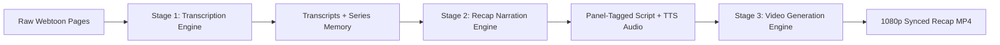
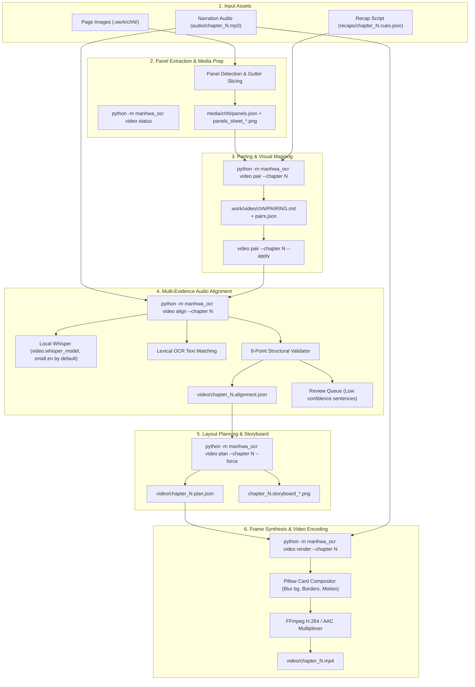
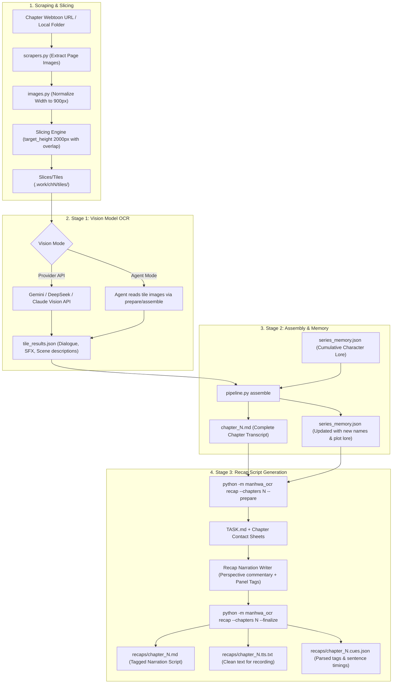
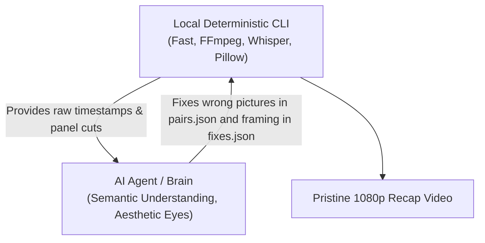

# `manhwa-ocr` System Architecture, Workflow & AI Dependency Guide

A comprehensive architectural manual and operational blueprint for the **Video Generation**, **Transcription**, and **Recap** subsystems of `manhwa-ocr`.

---

## 1. Executive Summary & System Philosophy

`manhwa-ocr` is a hybrid multimedia pipeline that transforms continuous-strip vertical webtoons (manhwa) into panel-aligned, broadcast-ready 1080p recap videos synchronized to voice narration.



The system is deliberately designed around a **separation of concerns**:
- **Deterministic Heavy Lifting** (OpenCV, Pillow, FFmpeg, Whisper): Image slicing, color extraction, aspect scaling, video frame composition, easing curves, and audio frequency analysis.
- **Cognitive / Semantic Intelligence** (Vision Models, LLMs, AI Agent "Brain"): Reading artistic hand-drawn typography, summarizing plot context across chapters, tagging sentences to storyboard panels, and making aesthetic crop decisions to prevent severed heads and speech bubbles.

---

## 2. Subsystem 1: Video Generation Engine

The video pipeline turns raw manhwa chapter images and a recorded narration MP3 into an animated 1080p video.

### 2.1 Video Generation Flowchart



---

### 2.2 Step-by-Step Video Generation Lifecycle

| Step | Command | Input Files | Output Files | What Happens Internally |
| :--- | :--- | :--- | :--- | :--- |
| **1. Panel Slicing** | Handled automatically or via `video build` | Normalized chapter strips | `media/chN/panels.json`, `panels_sheet_*.png` | Detects horizontal white/black gutters between webtoon panels, isolates discrete panels, and generates contact sheets for review. |
| **2. Pairing Review** | `python -m manhwa_ocr video pair --chapter N` | `panels.json`, `chapter_N.cues.json` | `.work/video/chN/PAIRING.md`, `pairing_NN.png`, `pairs.json` | Creates a visual sentence-by-sentence candidate grid. Green = tagged panel; Grey = subsequent panels in story order. |
| **3. Apply Pairing** | `python -m manhwa_ocr video pair --chapter N --apply` | Modified `pairs.json` | Updated tags in cues/memory | Commits any panel swaps made during pairing review into the session metadata. |
| **4. Speech Alignment** | `python -m manhwa_ocr video align --chapter N` | `audio/chapter_N.mp3`, cues, panels | `video/chapter_N.alignment.json` | Runs Whisper to get word-level audio timestamps. Evaluates whether each sentence is visual (`SHOW`) or non-visual (`HOLD_PREVIOUS`). Enforces 8 structural validation rules (no gaps, no overlaps, monotonic timing, no backward time jumps). Flags uncertain sentences into `review_queue`. |
| **5. Plan Assembly** | `python -m manhwa_ocr video plan --chapter N --force` | `chapter_N.alignment.json`, panels | `video/chapter_N.plan.json`, `chapter_N.storyboard_*.png` | Translates alignment choices into visual shots: sets camera motion (`push_in`, `pull_out`, `hold`), entrance animations (`fade_in`, `slide_left`, `slide_right`, `zoom_in`), layout (`single`, `pair`, `wide`), background blur, and generates storyboard contact sheets. |
| **6. Final Render** | `python -m manhwa_ocr video render --chapter N --workers 1` | `chapter_N.plan.json`, `chapter_N.mp3` | `video/chapter_N.mp4` | Renders 30 FPS video frames using Pillow (soft dropshadows, white card borders, rounded corners, motion easing) and streams raw frames directly to FFmpeg. |

---

### 2.3 Why a Terminal Build Can Stop, and What Fixes Each Stop

Running `python -m manhwa_ocr video build --chapter N` on a chapter whose recap and panel tags are
sound just works. When it stops, the message names the cause. These are the three usual ones:

1. **The alignment review queue (`--strict`) or a failed alignment check.**
   - `video align` decides the panel for each sentence from, in order, the recap's tag, the story
     order, and the overlap between the sentence and each panel's own text. A sentence whose tag it
     could not confirm is listed in `review_queue`; a tag sequence that jumps ahead without support
     fails `no_unexplained_jumps`.
   - The usual cause is **grouped tags**: one sentence carrying three or more tags followed by an
     untagged sentence. `video pair` reports it in `PAIRING.md` and writes a suggested redistribution
     into `pairs.json` (`_suggestions`, never applied for you); align's message names the exact
     sentence to move each tag to.
   - The fix is always in the tags: edit `pairs.json` (or the recap's `cues.json`), run
     `video pair --apply`, then `video align`. Nobody empties the queue or sets `reviewed` by hand;
     the only ways to clear the review gate are `video review` (the reviewer approves) and
     `video approve`.
2. **Framing.** Cards use only the allowed shapes (3:4, 1:1, 4:3, 16:9 landscape; 9:16, 3:4, 1:1
   portrait). The planner keeps every card full width with no white gutters, never starts a card
   below the top quarter of a panel whose head it cannot find, and shows a panel that is too wide for
   any shape whole on a blurred backdrop. `video verify` lists the panels it is unsure about
   (`low_confidence_heads`, `needs_eyes`) in `video/chapter_N.verify.json`.
3. **Speech bubbles.** The planner slides each crop away from lettering, vertical moves first, and
   narrows a card sideways only as a last resort (never below `video.crop.min_width_kept`).

Nobody computes `y0`/`y1` crop bounds by hand. If a panel still looks wrong after `video verify`,
the correction is one entry in `video/chapter_N.fixes.json` (`drop`, `face`, `crop`, or a `shot`
override of background or entrance). `video plan --force` re-applies that file every time it
rebuilds, so a fix is never lost; edits made directly in `chapter_N.plan.json` are.

---

### 2.4 How the AI Agent ("Brain") Helps, and the Lines It Does Not Cross

```mermaid
flowchart TD
    subgraph Tool ["Tool (deterministic)"]
        T1["align: panel per sentence"]
        T2["plan: shots, full-width crops, no gutters, head and bubble avoidance"]
        T3["verify: non-AI check of every drawn panel"]
        T4["review / approve: the gate before render"]
    end

    subgraph Agent ["Agent (judgement, through named files only)"]
        A1["Look at pair sheets; fix wrong pictures in pairs.json / cues.json"]
        A2["Look at the storyboard; record framing fixes in chapter_N.fixes.json"]
        A3["Re-run: pair --apply, align, plan --force, verify"]
    end

    subgraph Never ["Never by hand"]
        N1["y0 / y1 crop numbers in the plan"]
        N2['"reviewed": true or an emptied review queue']
        N3["cards[k].panel in the plan"]
    end

    Tool --> Agent
    Agent --> Tool
    Agent -. no .-> Never
    T4 --> OUT["Render: 1080p MP4"]
```

The agent's job is to look at pictures and decide, then write the decision into `pairs.json`,
`cues.json` or `fixes.json`. The tool does the arithmetic, the timing and the checks, and the plan
is always rebuilt from those files. Recording audio is the user's job, and a recap is never rewritten
once its chapter has audio.

---

## 3. Subsystem 2: Transcription & Recap Engine

Before video generation can begin, the chapter must be transcribed and turned into a panel-tagged narration recap.

### 3.1 Transcription & Recap Flowchart



---

### 3.2 Slicing & Quality Preservation Architecture

Vertical manhwa strips can be up to **900 × 20,000 pixels**. If a full page is sent to a vision model at once, it gets squashed down to ~110 px wide, rendering small font Korean/English illegible.
- `images.py` normalizes strips to a width of **900 px**.
- Slices into vertical windows of **target_height ~2000 px** with a 15% overlap.
- Overlaps ensure speech bubbles spanning across cuts are not split in half.
- Results are cached based on `image_hash + provider + prompt_version` so prompt adjustments do not re-trigger expensive vision inference.

### 3.3 Series Memory Architecture (`series_memory.json`)

Character identities and naming conventions fluctuate across fan translations. `series_memory.json` accumulates lore chronologically:
- **Characters**: Real names, aliases (e.g., *Bera* vs *Doran*, *Bargo Saintroar* vs *Holy Emperor*), relationships, appearance markers.
- **World & Lore**: Factions (Holy Empire, Gutter), divine artifacts (*Platinum Rosary of the Supreme God*), active oaths.
- **Chronological Rule**: Chapter $N$ only sees memory accumulated up to Chapter $N-1$ to prevent spoiler leakage into early chapter recaps.

---

## 4. Quantitative AI Dependency Matrix

How much of this system requires an AI Agent vs local code?

| System Component | Local Code (Deterministic) | AI Vision / LLM API | AI Agent ("Brain") | Why is the Agent Needed? |
| :--- | :---: | :---: | :---: | :--- |
| **Webtoon Slicing & Normalization** | **100%** | 0% | 0% | Pure OpenCV/Pillow pixel geometry. |
| **Panel Detection (`panels.json`)** | **100%** | 0% | 0% | Gutter brightness thresholding. |
| **Tile OCR Transcription** | 10% | **90%** (in API mode) | **90%** (in Agent mode) | Reading text inside artwork requires vision models. |
| **Assembly & Series Lore Tracking** | 30% | **70%** | **70%** | Reconciling character names, removing tile overlap duplicates. |
| **Writing Recap Narration Scripts** | 10% | **90%** | **90%** | Creative commentary, comedic timing, tagging panels (`{P004-05}`). |
| **Audio Speech Sync (Whisper)** | **100%** | 0% | 0% | Local Whisper (`video.whisper_model`; `small.en` by default, `base.en` is the faster option) timestamps words deterministically. |
| **Initial Video Alignment (`video align`)** | **85%** | 15% | 0% | Heuristic matching of speech against tags. |
| **Review Queue & Alignment Fixes** | 0% | 20% | **80%** | **Crucial:** Resolves flagged mismatches when text doesn't match OCR. |
| **Crop Bounds (`clean_art_bounds`)** | 40% | 0% | **60%** | **Crucial:** Prevents severed heads (`y0 <= 0.14`) and cut bodies (`y1 >= 0.90`). |
| **Frame Rendering & FFmpeg Compositing**| **100%** | 0% | 0% | Pure Pillow card rendering and FFmpeg H.264 encode. |

---

## 5. Master Workflow & Command Reference

### Phase A: Transcribe Chapter
```powershell
# 1. Start session (if new) or activate
python -m manhwa_ocr session use "manhwa-2"

# 2. Add chapter URLs into chapters.txt, then transcribe
python -m manhwa_ocr run --next --session "manhwa-2"
```

### Phase B: Write Recap Script
```powershell
# 1. Prepare recap prompt for chapter N
python -m manhwa_ocr recap --session "manhwa-2" --chapters N --prepare

# 2. Complete the recap script with panel tags {P00X-YY}, then finalize
python -m manhwa_ocr recap --session "manhwa-2" --finalize
# Outputs: recaps/chapter_N.tts.txt (Clean text for recording)
```

### Phase C: Record Audio Narration
- Record `recaps/chapter_N.tts.txt`.
- Save audio as `audio/chapter_N.mp3` (or `.wav` / `.m4a`).

### Phase D: Build and Render Video
```powershell
# 1. Check video pipeline status
python -m manhwa_ocr video status --session "manhwa-2"

# 2. Run pairing inspection (if needed)
python -m manhwa_ocr video pair --chapter N --session "manhwa-2"
python -m manhwa_ocr video pair --chapter N --apply --session "manhwa-2"

# 3. Align audio and build the plan (framing fixes live in video/chapter_N.fixes.json;
#    `plan --force` re-applies them every time)
python -m manhwa_ocr video align --chapter N --session "manhwa-2"
python -m manhwa_ocr video plan --chapter N --force --session "manhwa-2"

# 4. Check, review and approve the plan
python -m manhwa_ocr video verify --chapter N --session "manhwa-2"
python -m manhwa_ocr video review --chapter N --session "manhwa-2"
python -m manhwa_ocr video approve --chapter N --session "manhwa-2"

# 5. Render the 1080p video
python -m manhwa_ocr video render --chapter N --session "manhwa-2" --workers 1

# Optional: the intro (chapter 0), built from panels of any chapter
python -m manhwa_ocr video intro --prepare --session "manhwa-2"
python -m manhwa_ocr video intro --session "manhwa-2"
```

---

## 6. Summary: Why Pairing the AI Agent with Local CLI Produces Pristine Videos



1. **The CLI provides speed and stability**: It runs Whisper locally on CPU/GPU, detects gutters, generates contact sheets, and multiplexes 1080p frames at 30 FPS.
2. **The AI Agent provides aesthetic judgment**: It examines the contact sheets and storyboards and records what it sees as fixes (`pairs.json`, `cues.json`, `fixes.json`); the tool turns those into crops, timing and shots, so nothing is hand-computed.
3. **Together**: They eliminate manual video editing work while ensuring zero visual drift, zero severed heads, and zero terminal errors.
