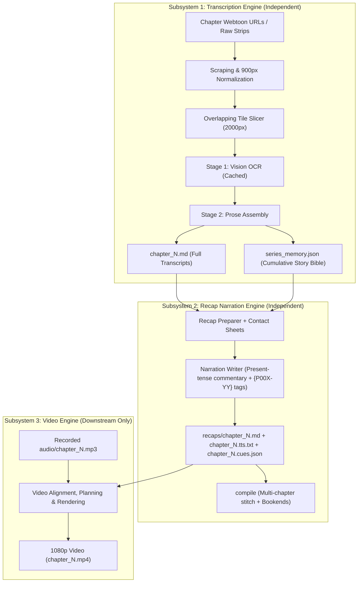
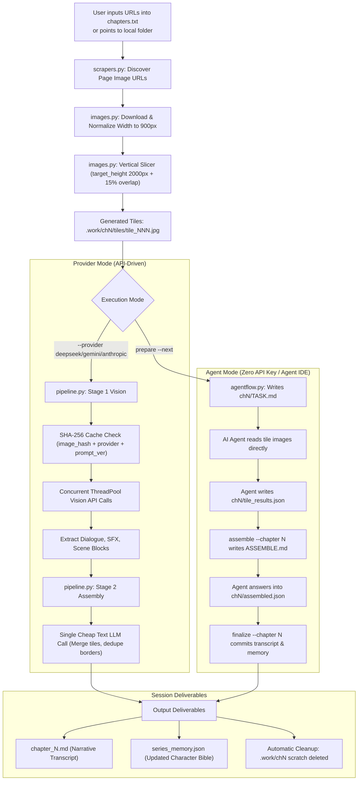
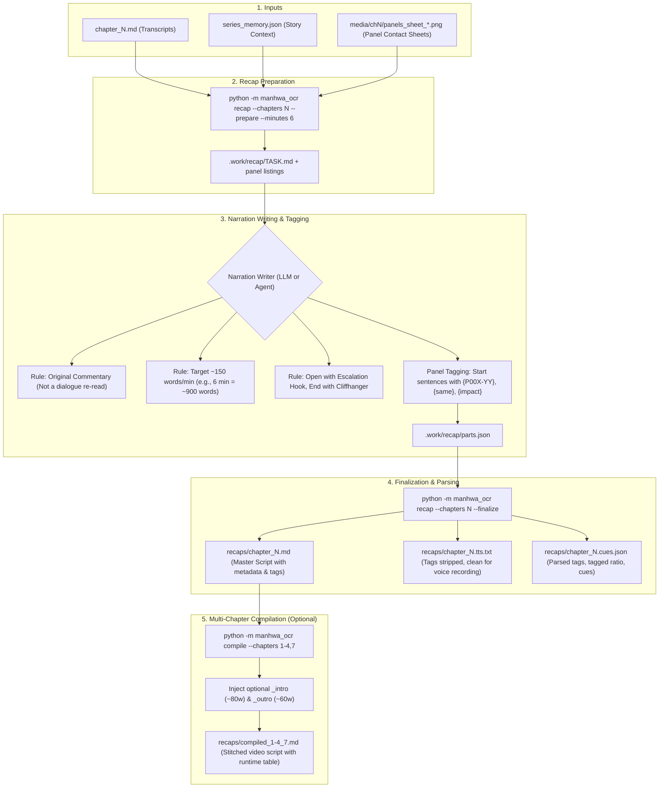

# `manhwa-ocr` Transcription & Recap Systems: Architecture & Workflow Guide

A comprehensive architectural manual, workflow blueprint, and AI dependency analysis for the **Transcription** and **Recap Narration** subsystems of `manhwa-ocr`.

---

## 1. Executive Architecture & Subsystem Independence

The `manhwa-ocr` engine is structured around three completely independent, loosely coupled layers. 



### Why Transcription & Recap are Completely Independent:
1. **Transcription requires ZERO audio and ZERO video**: It only converts visual manhwa strips into markdown transcripts and builds the cumulative story bible. You can transcribe 100 chapters without ever touching audio or video.
2. **Recap requires ZERO audio and ZERO video**: It transforms transcripts into written voiceover scripts (`.tts.txt`) and panel-tagged cue sheets (`.cues.json`). It does not need audio because the script is what the voice actor *reads to create* the audio.
3. **Pure File Handoffs**: Each stage reads and writes plain text/JSON files (`chapter_N.md`, `series_memory.json`, `chapter_N.tts.txt`). Progress is permanently saved to disk; if interrupted, it resumes without lost work.

---

## 2. Subsystem 1: The Transcription Engine

The transcription engine turns raw webtoon page strips into clean, narrative transcripts while accumulating character identities, visual appearance markers, and plot lore in `series_memory.json`.

### 2.1 Complete Transcription Pipeline Flowchart



---

### 2.2 Critical Engineering Details in Transcription

#### 1. Why Normalization and Slicing are Mandatory (`target_height: 2000px`)
- Webtoons are drawn as continuous vertical scrolling strips (typically 900 px wide by 10,000–25,000 px tall).
- If a vision model receives a 20,000 px strip, downscaling shrinks the width to ~100 px. Text and speech bubbles become illegible mush.
- `images.py` enforces:
  - Width normalized to exactly **900 px**.
  - Slices strips into vertical windows of **2,000 px**.
  - Adds **15% vertical overlap** between consecutive tiles so dialogue bubbles sitting on slice boundaries are never cut in half.

#### 2. The Two-Stage Cost & Cache Architecture (`pipeline.py`)
- **Stage 1 (Vision - Expensive)**: One vision model call per tile. Extracts structured blocks (speaker, text, visual description). Slices are cached per `SHA-256(image_hash + provider_fingerprint + PROMPT_VERSION)`. If you change the assembly prompt later, Stage 1 is never re-run, saving API costs and time.
- **Stage 2 (Assembly - Cheap Text Call)**: Flattens tile blocks, merges dialogue split across overlap seams, resolves pronouns, and formats the output into clean markdown prose.

#### 3. The Story Bible Engine (`series_memory.json`)
The story bible solves the core problem of long-running manhwa: **character names change across fan translations, and characters vanish for 15 chapters before returning.**
- **Append-Biased**: Facts are never deleted. If a character appears in shadow in chapter 10, it does not overwrite the detailed visual description recorded in chapter 2.
- **Visual Descriptors**: Stores markers like *"silver hair, red eyes, platinum rosary, scarred knuckles"*. This allows vision models to recognize characters even before their name is spoken.
- **Strict Chronological Isolation**: Chapter $N$ is only fed knowledge established up to Chapter $N-1$. Future spoilers cannot leak backward into early chapter recaps.
- **Safety Backups**: Every update automatically saves a copy to `series_memory.prev.json`.

---

## 3. Subsystem 2: The Recap Narration Engine

The recap engine transforms dry transcripts into conversational, YouTube-ready voiceover narration scripts tagged with exact visual panel markers.

### 3.1 Complete Recap Pipeline Flowchart



---

### 3.2 The Rules of Recap Narration Writing

1. **Original Commentary, Not Dialogue Reading**:
   - The script must sound like a professional recap creator explaining why the chapter matters to a friend.
   - It quotes the manhwa dialogue only when a line genuinely lands (1–3 times per chapter). Long blocks of dialogue recitation are forbidden.
2. **Strict Panel Tagging Syntax**:
   - Every spoken sentence begins with its visual card tag: `{P003-02} He finally draws the sword.`
   - `{P004-01,P004-02}`: Used when a sentence spans two panels (shown side-by-side or in sequence).
   - `{same}`: Holds the panel already on screen.
   - `{beat}`: Directs a 0.5s dramatic pause.
   - `{impact}`: Triggers camera shake on a blow, crash, or explosion.
   - `{reveal}`: Triggers an entrance zoom or card flip on a major plot reveal.
3. **The 3 Core Deliverables Produced**:
   - `recaps/chapter_N.md`: The complete markdown script containing metadata headers (`<!-- recap-meta {"chapter": "7", "words": 882, "tagged": 0.85} -->`).
   - `recaps/chapter_N.tts.txt`: **The recording script.** All `{P...}` tags, editing cues, and bracketed notes are stripped out. This is the clean text the creator records into the microphone.
   - `recaps/chapter_N.cues.json`: The machine-readable bridge used later by the video engine to know which sentence requested which panel.

---

## 4. Quantitative AI Dependency Matrix

| Step / Feature | Local Code (Deterministic) | AI Vision / LLM API | AI Agent ("Brain") | What Does the AI Do? |
| :--- | :---: | :---: | :---: | :--- |
| **Webtoon Slicing & Overlap** | **100%** | 0% | 0% | Pure pixel math and PIL image cutting. |
| **Panel Gutter Detection** | **100%** | 0% | 0% | White/black background luminance scanning. |
| **Tile OCR Reading** | 0% | **100%** (Provider Mode) | **100%** (Agent Mode) | Reading Korean/English dialogue in stylized graphic art. |
| **Transcript Prose Assembly** | 10% | **90%** | **90%** | Merging sliced speech bubbles into fluent markdown prose. |
| **Story Bible Updates** | 20% | **80%** | **80%** | Extracting character relationships, aliases, and plot lore. |
| **Recap Narration Writing** | 5% | **95%** | **95%** | Creative present-tense storytelling commentary. |
| **Panel Tagging (`{P00X-YY}`)**| 10% | **90%** | **90%** | Matching sentence meaning to contact sheet panel art. |
| **Script Tag Stripping (`.tts.txt`)**| **100%** | 0% | 0% | Regex-based removal of `{...}` and `[...]` tokens. |
| **Multi-Chapter Compilation** | **100%** | 0% | 0% | Plain text stitching and runtime table generation. |

---

## 5. Master Command Reference for Transcription & Recaps

### 5.1 Transcription Workflows

#### Mode A: Automated API Provider Mode (Gemini / DeepSeek / Claude / OpenAI)
```powershell
# Transcribe next pending chapter
python -m manhwa_ocr run --next --session "manhwa-2"

# Transcribe all pending chapters in chapters.txt
python -m manhwa_ocr run --all-pending --session "manhwa-2"

# Transcribe from a specific local image folder
python -m manhwa_ocr run --folder ./local_raws --chapter 7 --session "manhwa-2"
```

#### Mode B: Agent Mode (When you have NO API Key)
```powershell
# 1. Download, normalize, slice, and generate TASK.md
python -m manhwa_ocr prepare --next --session "manhwa-2"

# 2. Agent reads tiles, writes .work/chN/tile_results.json, then:
python -m manhwa_ocr assemble --chapter N --session "manhwa-2"

# 3. Agent answers ASSEMBLE.md into assembled.json, then:
python -m manhwa_ocr finalize --chapter N --session "manhwa-2"
```

---

### 5.2 Recap Narration Workflows

```powershell
# 1. Prepare recap task for chapter 7 (sets target to 6 minutes)
python -m manhwa_ocr recap --session "manhwa-2" --chapters 7 --prepare --minutes 6

# 2. Inspect contact sheets (media/ch7/panels_sheet_*.png), write tagged narration into .work/recap/parts.json, then:
python -m manhwa_ocr recap --session "manhwa-2" --finalize

# Output files created:
# - recaps/chapter_7.md        (Tagged script)
# - recaps/chapter_7.tts.txt    (Clean voiceover script to read)
# - recaps/chapter_7.cues.json  (Structural cues)

# 3. (Optional) Force rewrite an existing recap with tags
python -m manhwa_ocr recap --session "manhwa-2" --chapters 7 --prepare --force

# 4. (Optional) Stitch multiple chapters into one master video script
python -m manhwa_ocr compile --session "manhwa-2" --chapters 1-4,7
```

---

## 6. Summary: How All Three Subsystems Form the Complete Pipeline

| Subsystem | Input | Output | Can It Run By Itself? |
| :--- | :--- | :--- | :--- |
| **1. Transcription** | Raw Webtoon Images | `chapter_N.md` + `series_memory.json` | **YES.** Pure OCR and story bible building. |
| **2. Recap Narration**| `chapter_N.md` + `series_memory.json` | `chapter_N.tts.txt` + `chapter_N.cues.json` | **YES.** Pure creative writing and panel tagging. |
| **3. Video Generation**| `chapter_N.cues.json` + `audio/chapter_N.mp3` | `chapter_N.mp4` | **Depends on 1 & 2.** Needs tags and voice audio. |
